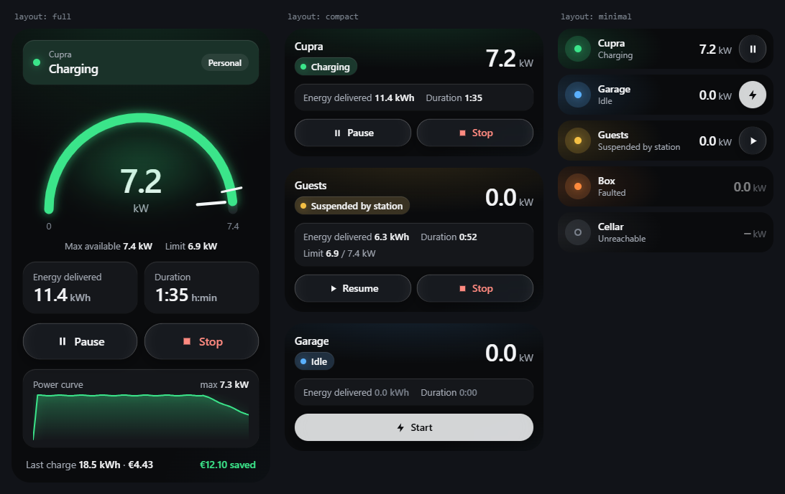
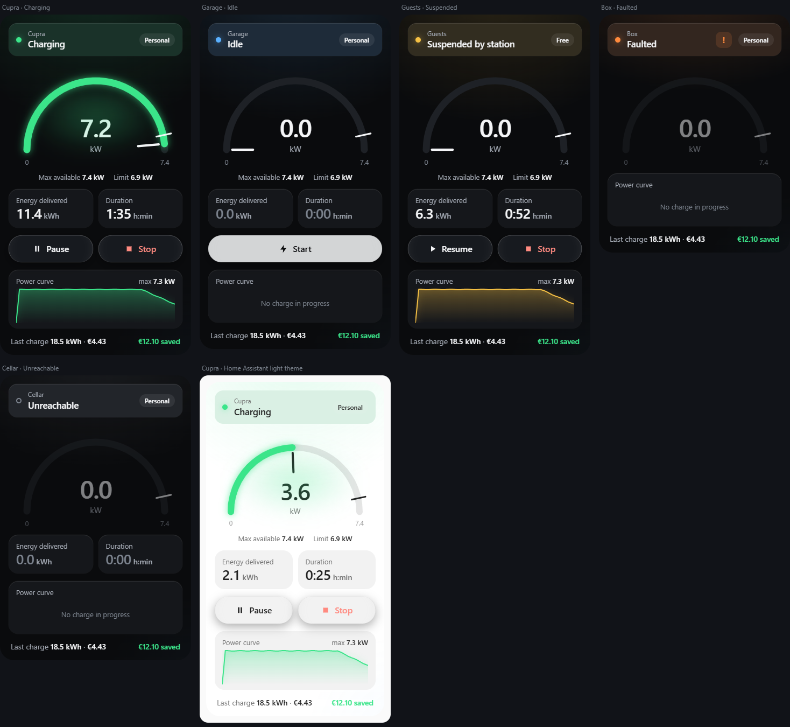
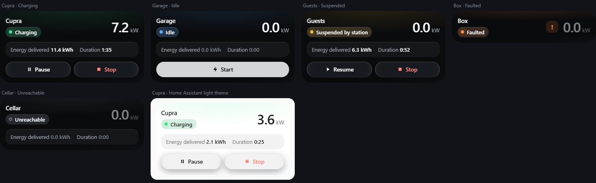
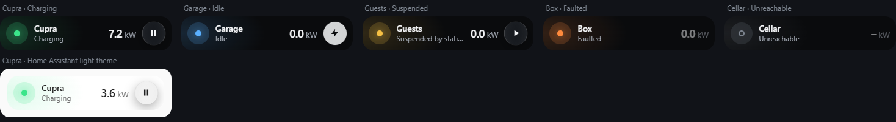

# Wallbox WEB card

🇬🇧 [English](README.md)

[](https://my.home-assistant.io/redirect/hacs_repository/?owner=Filpin011&repository=wallbox-web-card&category=plugin)
[](https://github.com/Filpin011/wallbox-web-card/actions/workflows/ci.yml)
[](https://github.com/Filpin011/wallbox-web-card/actions/workflows/validate.yml)

> **Progetto indipendente e non ufficiale.** Nato dallo studio di come le colonnine comunicano sulla rete locale
> (interoperabilità). **Non è affiliato, approvato né supportato da SCAME PARRE S.p.A.** "Scame" e i marchi
> collegati appartengono ai rispettivi titolari e sono citati solo per indicare i dispositivi compatibili. Nessuna
> garanzia: la usi a tuo rischio. Dettagli: [DISCLAIMER.md](DISCLAIMER.md).

Card per le dashboard di Home Assistant con l'aspetto della schermata **Stato** dell'app Wallbox WEB (scura,
Liquid Glass): banda di stato con pillola della modalità, indicatore di potenza a semicerchio con bagliore e limite,
riquadri Energia e Durata, pulsanti in vetro **Avvia / Pausa / Riprendi / Ferma**, mini curva della potenza della
ricarica in corso e ultima ricarica con costo e risparmio. Tre layout – **completo**, **compatto** e **minimo** – e
un interruttore per ogni blocco.

La card segue la lingua di Home Assistant: **inglese** di default, **italiano** disponibile.



## Requisiti

- Home Assistant **2026.11** o successivo.
- L'integrazione **[Wallbox WEB](https://github.com/Filpin011/ha-wallbox-web)** configurata: la card legge le sue
  entità e preme i suoi pulsanti.

## Installazione

### Con HACS (consigliato)

1. Premi **Apri in HACS** qui sopra, oppure HACS › ⋮ › **Repository personalizzati** › URL
   `https://github.com/Filpin011/wallbox-web-card`, tipo **Dashboard**.
2. **Scarica**. HACS aggiunge da solo la risorsa della dashboard.
3. Ricarica la pagina del browser (o chiudi e riapri l'app Companion).

### Manuale (Samba / File editor)

1. Scarica `wallbox-web-card.js` dall'ultima [release](https://github.com/Filpin011/wallbox-web-card/releases) e
   copialo in `/config/www/wallbox-web-card.js` (Samba: `\\homeassistant\config\www\`).
2. Impostazioni › Dashboard › ⋮ › **Risorse** › **Aggiungi risorsa**: URL `/local/wallbox-web-card.js?v=0.2.0`,
   tipo **Modulo JavaScript** (serve la *Modalità avanzata* nel profilo utente). Cambia `?v=` a ogni aggiornamento.
3. Ricarica la pagina.

## Uso

Modifica dashboard › **Aggiungi card** › cerca **Wallbox WEB** › scegli la **colonnina** nell'editor visuale, poi il
**layout**; la sezione **Contenuti** elenca i blocchi di quel layout. La card compare anche tra i suggerimenti quando
scegli l'entità *Stato* di una colonnina.

### Layout

| `layout` | Cosa mostra | Dimensione nella vista a sezioni |
|---|---|---|
| `full` (default) | banda di stato, indicatore di potenza, massimo / limite, riquadri energia e durata, pulsanti, curva, ultima ricarica | larghezza piena, altezza secondo il contenuto |
| `compact` | nome + pillola di stato + potenza, energia e durata su una riga, pulsanti piccoli (senza indicatore) | larghezza piena, altezza secondo il contenuto |
| `minimal` | una riga come la card Riquadro: punto di stato, nome, potenza, un pulsante (Avvia, Riprendi, Pausa o Ferma) | mezza sezione, una riga (ridimensionabile) |

**Completo** – in carica, disponibile, sospesa, guasto, non raggiungibile, tema chiaro di Home Assistant:



**Compatto:**



**Minimo** (una riga da 56 px della vista a sezioni):



```yaml
type: custom:wallbox-web-card
device_id: 0123456789abcdef0123456789abcdef  # scelto dall'editor
layout: compact
name: Garage            # facoltativo (default: nome del dispositivo)
show_tiles: true
show_actions: true
tap_action:
  action: navigate
  navigation_path: /dashboard-energy
```

### Opzioni

| Opzione | Default | Descrizione |
|---|---|---|
| `device_id` | – | dispositivo della colonnina (integrazione Wallbox WEB), obbligatorio |
| `layout` | `full` | `full`, `compact` o `minimal` |
| `name` | nome del dispositivo | testo sopra / accanto allo stato |
| `show_status` | `true` | banda di stato (completo), pillola (compatto), riga di stato sotto il nome (minimo) |
| `show_gauge` | `true` | indicatore di potenza (solo completo) |
| `show_limits` | `true` completo, `false` compatto | potenza massima disponibile e limite (e tacca del limite sull'indicatore) |
| `show_tiles` | `true` | energia erogata e durata della ricarica in corso |
| `show_actions` | `true` | Avvia / Pausa / Riprendi / Ferma (solo i comandi possibili; nascosti se il token è di sola lettura). Minimo: un pulsante |
| `show_curve` | `true` completo, `false` compatto | curva della ricarica in corso (registratore del server) o storico del sensore Potenza |
| `show_last_charge` | `true` completo, `false` compatto | energia, costo e risparmio dell'ultima ricarica |
| `curve_hours` | `6` | finestra dello storico per la curva se il server non fornisce la curva della ricarica |
| `appearance` | `app` | `app` = aspetto Wallbox WEB (scuro); `theme` = colori del tema di Home Assistant |
| `tap_action` | dettagli di *Potenza* | [azione](https://www.home-assistant.io/dashboards/actions/) standard al tocco dell'indicatore (completo), dell'intestazione (compatto) o della riga (minimo) |

Le opzioni che un layout non ha (es. `show_gauge` in `compact`) vengono ignorate. Tocca la banda di stato o i
riquadri per aprire i dettagli dell'entità. I colori si possono cambiare da un tema di Home Assistant:
`wallbox-accent`, `wallbox-info`, `wallbox-warning`, `wallbox-fault`, `wallbox-danger`, `wallbox-bg`,
`wallbox-surface`, `wallbox-text`.

Rispetta *Riduci movimento* e *Riduci trasparenza* del sistema.

## Usare le card integrate di Home Assistant

Non serve questa card per mettere la colonnina in una dashboard: le entità dell'integrazione funzionano con le card
incluse in Home Assistant. Per una colonnina chiamata **Garage** con Home Assistant in italiano
(`sensor.garage_potenza`, …):

```yaml
# Riquadro con andamento della potenza e barra
type: tile
entity: sensor.garage_potenza
features_position: bottom
features:
  - type: trend-graph
    hours_to_show: 6
  - type: bar-gauge
    min: 0
    max: 7.4
```

```yaml
# Riquadro che avvia la ricarica (pulsante disattivato quando l'azione non è possibile)
type: tile
entity: button.garage_avvia_ricarica
features:
  - type: button
    action_name: Avvia
```

```yaml
type: gauge
entity: sensor.garage_potenza
unit: kW
min: 0
max: 7.4
needle: true
```

```yaml
type: statistics-graph
entities:
  - sensor.garage_energia_totale
stat_types:
  - change
period: day
chart_type: bar
```

Altri esempi (card Entità, grafico storico, dashboard Energia) nel README dell'integrazione:
[Usare le card integrate di Home Assistant](https://github.com/Filpin011/ha-wallbox-web/blob/main/README.it.md#usare-le-card-integrate-di-home-assistant).

## Risoluzione problemi

- **"Custom element doesn't exist: wallbox-web-card"**: manca la risorsa o è in cache. Controlla Impostazioni ›
  Dashboard › ⋮ › Risorse, poi ricarica la pagina (app Companion: Impostazioni › App Companion › Debug › Reimposta la
  cache del frontend).
- **"Colonnina non trovata"**: il dispositivo non ha l'entità *Stato* di Wallbox WEB; controlla l'integrazione.
- **Nessun pulsante**: il token dell'integrazione è di sola lettura, oppure nessun comando è possibile nello stato
  attuale (come nell'app).
- **Curva vuota**: nessuna ricarica in corso, oppure il server non registra le ricariche e il sensore Potenza non ha
  storico nelle ultime `curve_hours` ore.

## Sviluppo

Vedi [CONTRIBUTING.md](CONTRIBUTING.md) (in inglese): `npm ci`, `npm test`, `npm run build`, `npm run demo`.

## Licenza

[MIT](LICENSE)
