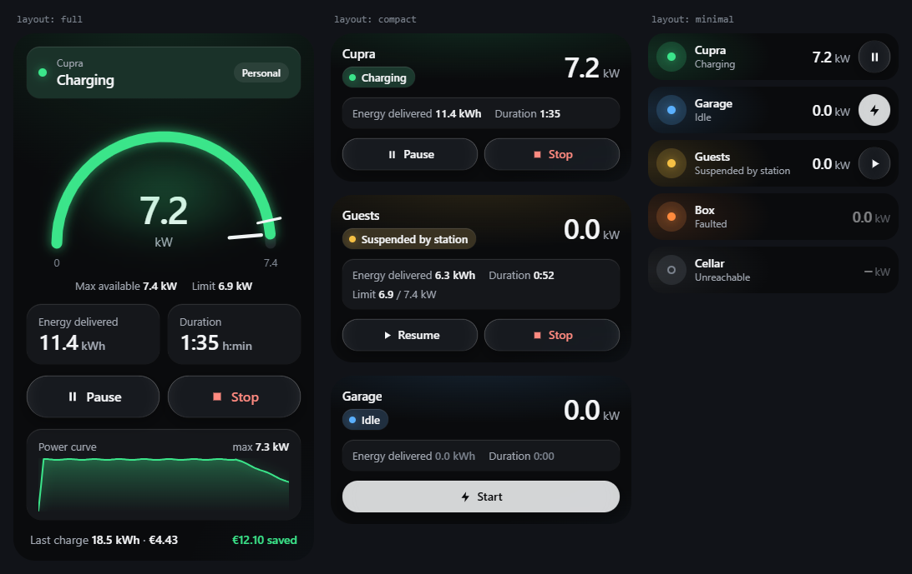
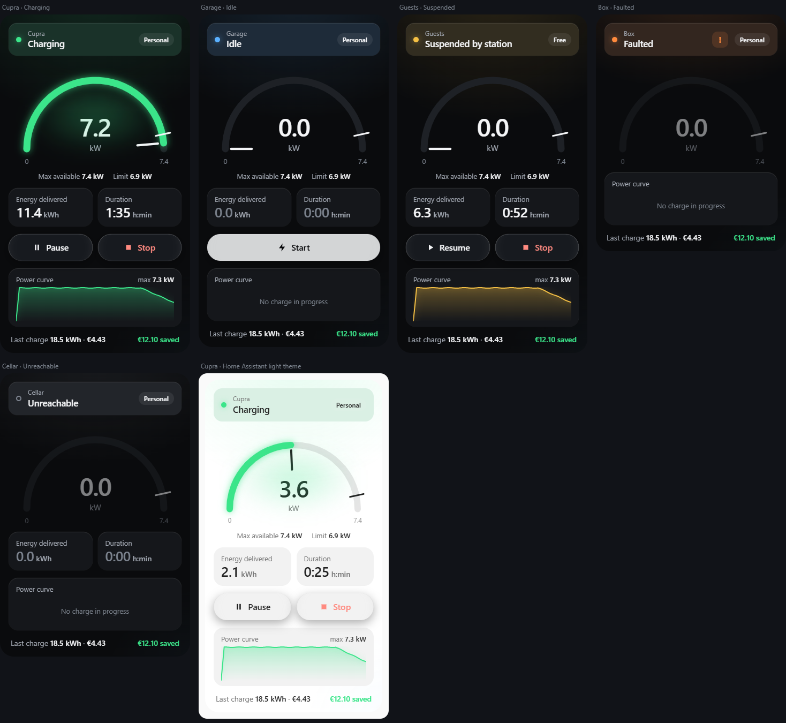
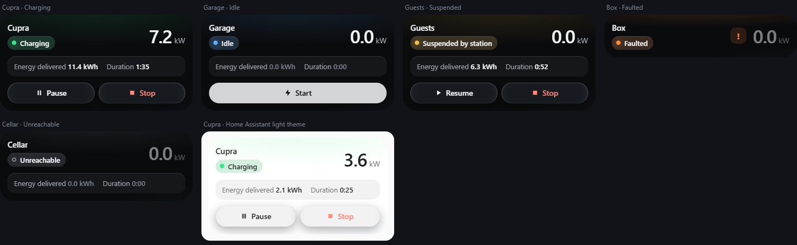
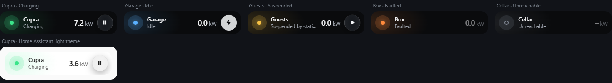

# Wallbox WEB card

🇮🇹 [Italiano](README.it.md)

[](https://my.home-assistant.io/redirect/hacs_repository/?owner=Filpin011&repository=wallbox-web-card&category=plugin)
[](https://github.com/Filpin011/wallbox-web-card/actions/workflows/ci.yml)
[](https://github.com/Filpin011/wallbox-web-card/actions/workflows/validate.yml)

> **Independent, unofficial project.** It comes from a study of how the charging stations communicate on the local
> network (interoperability). **Not affiliated with, endorsed or supported by SCAME PARRE S.p.A.** "Scame" and
> related trademarks belong to their respective owners and are mentioned only to identify compatible devices. No
> warranty: use it at your own risk. Details: [DISCLAIMER.md](DISCLAIMER.md).

Home Assistant dashboard card with the look of the Wallbox WEB app's **Status** screen (dark, Liquid Glass): status
band with the mode pill, half-circle power gauge with glow and limit, Energy and Duration tiles, glass
**Start / Pause / Resume / Stop** buttons, a mini curve of the current charge and the last charge with cost and
saving. Three layouts – **full**, **compact** and **minimal** – and a switch for every block.

The card follows your Home Assistant language: **English** by default, **Italian** available.



## Requirements

- Home Assistant **2026.11** or later.
- The **[Wallbox WEB](https://github.com/Filpin011/ha-wallbox-web)** integration, configured: the card reads its
  entities and presses its buttons.

## Installation

### With HACS (recommended)

1. Press **Open in HACS** above, or HACS › ⋮ › **Custom repositories** › URL
   `https://github.com/Filpin011/wallbox-web-card`, type **Dashboard**.
2. **Download**. HACS adds the dashboard resource by itself.
3. Reload the browser page (or close and reopen the Companion app).

### Manual (Samba / File editor)

1. Download `wallbox-web-card.js` from the latest [release](https://github.com/Filpin011/wallbox-web-card/releases)
   and copy it to `/config/www/wallbox-web-card.js` (Samba: `\\homeassistant\config\www\`).
2. Settings › Dashboards › ⋮ › **Resources** › **Add resource**: URL `/local/wallbox-web-card.js?v=0.2.0`, type
   **JavaScript module** (requires *Advanced mode* in your user profile). Change `?v=` on every update.
3. Reload the page.

## Usage

Edit dashboard › **Add card** › search for **Wallbox WEB** › pick the **station** in the visual editor, then the
**layout**; the **Content** section lists the blocks of that layout. The card is also suggested when you pick a
station's *Status* entity.

### Layouts

| `layout` | What it shows | Sections view size |
|---|---|---|
| `full` (default) | status band, power gauge, max / limit, energy and duration tiles, buttons, power curve, last charge | full width, height follows the content |
| `compact` | name + status pill + power value, energy and duration on one row, small buttons (no gauge) | full width, height follows the content |
| `minimal` | one row like a tile card: status dot, name, power, one button (Start, Resume, Pause or Stop) | half a section, one row (resizable) |

**Full** – charging, idle, suspended, faulted, unreachable, Home Assistant light theme:



**Compact:**



**Minimal** (one 56 px row of the sections view):



```yaml
type: custom:wallbox-web-card
device_id: 0123456789abcdef0123456789abcdef  # picked in the editor
layout: compact
name: Garage            # optional (default: device name)
show_tiles: true
show_actions: true
tap_action:
  action: navigate
  navigation_path: /dashboard-energy
```

### Options

| Option | Default | Description |
|---|---|---|
| `device_id` | – | station device (Wallbox WEB integration), required |
| `layout` | `full` | `full`, `compact` or `minimal` |
| `name` | device name | text shown above / next to the status |
| `show_status` | `true` | status band (full), status pill (compact), status line under the name (minimal) |
| `show_gauge` | `true` | power gauge (full only) |
| `show_limits` | `true` full, `false` compact | max available power and power limit (and the limit tick on the gauge) |
| `show_tiles` | `true` | energy delivered and duration of the current charge |
| `show_actions` | `true` | Start / Pause / Resume / Stop (only the possible commands; hidden for a read-only token). Minimal: one button |
| `show_curve` | `true` full, `false` compact | curve of the current charge (server recorder) or history of the Power sensor |
| `show_last_charge` | `true` full, `false` compact | energy, cost and saving of the last charge |
| `curve_hours` | `6` | history window of the curve when the server has no charge curve |
| `appearance` | `app` | `app` = Wallbox WEB look (dark); `theme` = your Home Assistant theme colours |
| `tap_action` | more-info of *Power* | standard [action](https://www.home-assistant.io/dashboards/actions/) when tapping the gauge (full), the header (compact) or the row (minimal) |

Options that a layout does not have (e.g. `show_gauge` in `compact`) are ignored. Tap the status band or the tiles to
open the entity's details. Colours can be changed from a Home Assistant theme: `wallbox-accent`, `wallbox-info`,
`wallbox-warning`, `wallbox-fault`, `wallbox-danger`, `wallbox-bg`, `wallbox-surface`, `wallbox-text`.

The card respects the system's *Reduce motion* and *Reduce transparency* settings.

## Use the built-in Home Assistant cards

You do not need this card to put the charger on a dashboard: the integration's entities work with the cards that
ship with Home Assistant. For a station named **Garage** (English entity ids, `sensor.garage_power`, …):

```yaml
# Tile with a power trend and a bar gauge
type: tile
entity: sensor.garage_power
features_position: bottom
features:
  - type: trend-graph
    hours_to_show: 6
  - type: bar-gauge
    min: 0
    max: 7.4
```

```yaml
# Tile that starts charging (the button is greyed out when the action is not possible)
type: tile
entity: button.garage_start_charging
features:
  - type: button
    action_name: Start
```

```yaml
type: gauge
entity: sensor.garage_power
unit: kW
min: 0
max: 7.4
needle: true
```

```yaml
type: statistics-graph
entities:
  - sensor.garage_lifetime_energy
stat_types:
  - change
period: day
chart_type: bar
```

More examples (entities card, history graph, Energy dashboard, Italian entity ids) are in the integration's README:
[Use the built-in Home Assistant cards](https://github.com/Filpin011/ha-wallbox-web#use-the-built-in-home-assistant-cards).

## Troubleshooting

- **"Custom element doesn't exist: wallbox-web-card"**: the resource is missing or cached. Check Settings ›
  Dashboards › ⋮ › Resources, then reload the page (Companion app: Settings › Companion app › Debugging › Reset
  frontend cache).
- **"Station not found"**: the device has no Wallbox WEB *Status* entity; check the integration.
- **No buttons**: the integration's token is read-only, or no command is possible in the current state (as in the app).
- **Empty curve**: there is no charge in progress, or the server has no charge recorder and the Power sensor has no
  history in the last `curve_hours`.

## Development

See [CONTRIBUTING.md](CONTRIBUTING.md): `npm ci`, `npm test`, `npm run build`, `npm run demo` (mocked Home Assistant,
English; `?lang=it` for Italian).

## License

[MIT](LICENSE)
